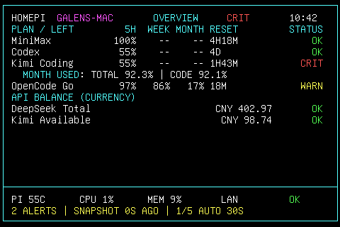
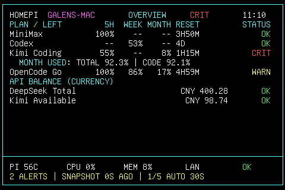
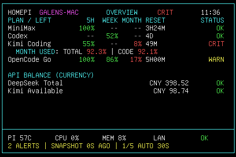
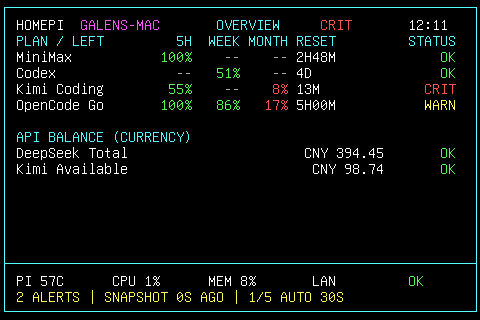
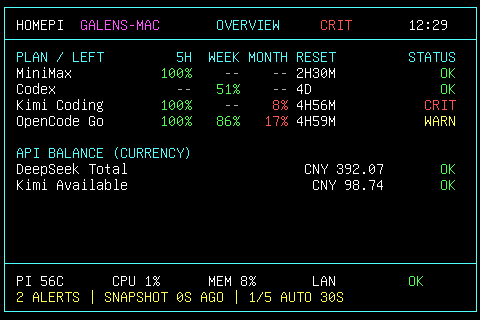

# 模块 002 测试文档：TUI Dashboard

> 对应规格：Module-Spec-002-TUIDashboard.md
> 状态：Grok weekly 两行布局与 5H 缺失占位符自动化、DietPi ARM64 TTY 链路通过；用户肉眼确认仍保留为最终验收边界
> 最近执行：2026-08-24，Grok weekly-only 卡片、四 Coding 卡片容量、stale 布局修复、DietPi ARM64 部署与 `5H --` TTY 读取

Phase 2 Web Admin 对 Display 候选环境、SSH 原子部署和回滚的测试记录在
`Test-Module-005-WebAdmin.md`；本文件继续负责 TUI、Kiosk、快照和 systemd 运行契约。

## 1. Unit Test

| ID | 输入/前置条件 | 预期输出 | 实际输出 | 结果 |
|---|---|---|---|---|
| U001 | 60×20 终端、3 个 Coding Plan 与 2 个 API 余额 | 选择 compact 布局，五类卡片的主值与状态均不截断 | 通过。`TestGoldenScreens/overview_live`：五类卡片主值、窗口、重置、状态全部完整可见，与 golden 逐字节一致 | 通过 |
| U002 | 终端小于最低尺寸 | 显示诊断页，不发生越界或 panic | 通过。运行时读取 `TIOCGWINSZ`；`TestSmallTerminalDiagnosticFitsAndUsesASCII` 验证 32×6 诊断页严格适配、只含 7-bit ASCII | 通过 |
| U003 | status=critical、ASCII 模式 | 使用 CRIT 文案表达，不只依赖颜色 | 通过。`TestStatusesAreTextOnly`：八种状态均以文本可辨，ASCII 渲染不输出颜色转义 | 通过 |
| U004 | estimated 指标低于 critical 阈值 | 最多显示 warning/estimate，不伪装精确 critical | 通过。`TestSoftPrecisionCapsAtWarning`：estimated/manual 在 3% 剩余时封顶 WARN，exact 同值为 CRIT；`TestEstimatedValueIsLabelled` 验证 EST 标签 | 通过 |
| U005 | observed_at 超过 stale_after | 保留数值并显示 STALE 与距今时间 | 通过。`TestDeriveDisplayStatusSemantics`（过期预算、逐指标 stale_after 覆盖两例）；`TestOfflineFooter` 验证 `DATA STALE 12M` | 通过 |
| U006 | 同一 source_epoch 接收 snapshot version 9，当前为 10 | 丢弃旧快照，页面不回退 | 通过。`TestSupersedesRejectsVersionRegression`；`syncclient.applySnapshot` 在 Supersedes 失败时直接丢弃且不通知重绘 | 通过 |
| U007 | 快照含未知可选字段 | 忽略字段并正常渲染 | 通过。`TestDecodeIgnoresUnknownFields`：顶层与 metric 层各注入一个未知字段，解码成功且指标不丢失 | 通过 |
| U008 | 快照主 schema 版本不兼容 | 显示升级提示，不加载错误数据 | 部分通过。`TestDecodeRejectsIncompatibleMajor` 与 `TestIncompatibleSchemaIsQuarantined`：拒绝加载并隔离文件；服务端在 hello 阶段回 `schema_unsupported` 并关闭连接。屏幕上的专用升级提示页属 P1-07 | 部分通过 |
| U009 | 最近成功 JSON 快照损坏 | 隔离损坏单文件，进入空状态，进程不退出且不创建 SQLite | 通过。`TestCorruptSnapshotIsQuarantined`：损坏文件移至 `last-known-good.corrupt`，返回 ErrNoSnapshot，后续正常写入可完全恢复；`syncclient.New` 对该错误只记日志不退出 | 通过 |
| U010 | 200 ms 内连续到达 8 个 delta | 合并更新，重绘次数受限且最终状态正确 | 部分通过。`Changed()` 为深度 1 缓冲通道，`loop` 收到信号后等待 200 ms 合并窗口并 `drainChanges` 再单次重绘；`screen.draw` 对相同帧不写终端。实测重绘计数属 P1-07 | 部分通过 |
| U011 | stdin 关闭，Phase 1 启动 | 固定显示 overview，不等待输入、不退出 | 通过（手动冒烟）。display 在 stdout 重定向到文件、无 TTY 的条件下正常渲染并持续运行；代码中无任何 stdin 读取路径 | 通过 |
| U012 | 随机按键/鼠标转义事件输入 TTY | 页面和配置不变化，进程继续运行 | 通过（结构性）。`cmd/homepi-display` 不读 stdin、不启用 mouse mode、不注册按键；rich 主题只追加渲染器生成的白名单 SGR | 通过 |
| U013 | show_message 含 ANSI escape | 文本被清理，终端状态不被注入改变 | 通过。`TestANSIEscapesAreStripped`：Provider 名、节点别名、金额三处注入 `\x1b[2J`、`\x07`、`\r\n`，渲染后无任何控制字节 | 通过 |
| U014 | source_epoch 改变且新 version=0 | 接受新 daemon 的完整快照并替换当前状态 | 通过。`TestSupersedesAcceptsNewEpochFromZero`、`TestDaemonRestartIsAcceptedAsNewEpoch` | 通过 |
| U015 | 终端实际尺寸不是 60×20 | 以运行时尺寸选择布局并记录诊断，不盲用照片推断值 | 部分通过。`ioctlWinsize` 使用 `TIOCGWINSZ` 取实际尺寸，`doctor` 输出实际值并与 60×20 基线对比告警。运行时降级布局属 P1-07 | 部分通过 |
| U016 | 当前绑定 node=A，收到 node=B 快照 | 拒绝 B，不合并或覆盖 A 的 UI 数据，并记录 wrong_source | 通过。`TestSourceBindingRejectsForeignNode`、`TestForeignNodeIsRejected`、`TestForeignSnapshotIsRejected`：既不保存也不加载，客户端记录 source_node 与 bound_to 的诊断 | 通过 |
| U017 | ASCII 模式渲染 Phase 1 正常、离线、认证失败状态 | 每行宽度不超过 60 单元，总高度不超过 20 行，仅使用 7-bit ASCII | 通过。`TestGridIsAlwaysExact`：正常/离线/AUTH/空/严重/恶意输入六种模型，每帧恰好 20 行 × 60 单元，全部字节位于 0x20–0x7e | 通过 |
| U018 | 终端无颜色且不支持 Unicode，配置 `style=ascii` | 框线、进度条和状态文本结构完整，输出与既有 golden 逐字节一致 | `TestASCIIStyleMatchesExistingGoldenRenderer` 对四种状态逐字节一致，且不含 escape；Pi 当前二进制 ASCII 冒烟同样无 rich SGR/字形 | 通过 |
| U019 | WebSocket 会话收到有效快照或心跳后断开 | 下一次重连从首次失败退避开始，不累积历史独立故障 | 通过。`session` 仅在有效快照/心跳后返回 healthy，`TestNextFailureCountResetsAfterHealthySession` 验证健康会话后计数重置为 1 | 通过 |
| U020 | 保存最近成功快照 | 临时文件和父目录均完成同步后返回成功 | 通过。`Store.Save` 在 rename 后调用平台 `syncDir`，`TestSyncDir` 在 Unix 测试目录执行真实目录 fsync | 通过 |
| U021 | DietPi systemd unit 与环境模板 | unit 绑定 tty1、等待 getty 完全停止、stdin=null、失败退避、自启动；Token 只引用环境变量且模板权限要求 0600 | 通过。测试同时锁定 `Conflicts=getty@tty1.service` 与 `After=getty@tty1.service`；Pi 上从 active getty 启动后 getty 变 inactive、display active、完整首屏保留 | 通过 |
| U022 | Kiosk stdin 为关闭的 pipe，连续重绘与退出 | 不读 stdin、不启用 mouse mode，隐藏光标，退出恢复光标 | 通过。`TestScreenIsOutputOnlyAndRestoresCursor` 验证隐藏/恢复光标、无 mouse mode、相同帧不重复写；运行参数可全由环境文件注入 | 通过 |
| U023 | 目标 Pi 首次 `enable --now`，getty@tty1 原先活动 | getty 完全停止后 Kiosk 才绘制；进程 active、快照落盘且 `/dev/vcs1` 同时出现 HomePi 首屏 | 通过。修复后真实执行 getty active → start display：getty inactive、display active，1,200 字节字符屏有 661 个非空格字符并呈现完整 60×20 首屏 | 通过 |
| U024 | 原子快照写入期间进程被强制停止，目录遗留 `last-known-good.json.tmp-*` | 下次启动清理同前缀普通临时文件；符号链接安全失败且不影响外部目标 | 通过。`TestNewRemovesInterruptedTempFile` 与 `TestNewRefusesInterruptedTempSymlink` 通过；Pi 启动前复现 1 个遗留文件，升级启动后为 0，主快照与首屏正常 | 通过 |
| U025 | rich 渲染正常/离线/AUTH/空/严重/恶意输入六种模型 | 剥离 ANSI 后每帧 20×60；只含指定单宽字符；无输入控制字符幸存 | `TestRichGridAndGlyphWhitelist`、`TestRichUsesOnlyApprovedSGRAndResetsEveryLine`：六种模型全部满足，恶意输入无 escape 逸出 | 通过 |
| U026 | rich 的 LIVE/OK/WARN/CRIT/AUTH/STALE/OFFLINE/WAIT | 状态文本保留，并使用规格映射的 SGR 颜色；reset 不跨行泄漏 | `TestRichStatusPaletteKeepsText` 覆盖 8 种 DisplayStatus，`TestRichLinkPalette` 覆盖 4 种 LinkStatus；20 行均以 reset 结束 | 通过 |
| U027 | `style=rich`、`style=ascii`、未知值 | 默认 rich；ASCII 与 golden 一致；未知值返回明确错误 | `ParseStyle` 接受大小写与首尾空白；默认 rich；`rainbow` 返回 `want rich or ascii`；环境/flag 路径通过 | 通过 |
| U028 | 相同 ViewModel 各用 rich/ASCII 渲染 20 次 | 每个主题内部逐字节确定，相同帧仍被去重 | 两主题各重复 20 次完全一致；`TestScreenIsOutputOnlyAndRestoresCursor` 继续证明相同帧不写，并新增样式恢复 reset | 通过 |
| U029 | rich 正常、WARN、CRIT 三种卡片 | 所有画面外框均为亮青；进度括号/`█` 均为亮青、`░` 均为亮黄；状态徽标仍按独立语义色变化 | `TestRichBrightBorderAndCyanYellowProgress` 三组均通过：外框/括号/`█`=`1;36`，`░`=`1;33`，徽标分别为绿/黄/红 | 通过 |
| U030 | balance 主值为 `1`、`1.2`、`1.235` | TUI 分别显示 `CNY 1.00`、`CNY 1.20`、`CNY 1.24`，ASCII/rich 语义一致 | `TestBuildFormatsBalancesWithExactlyTwoDecimals` 生成三张卡片，金额文本分别为 `CNY 1.00`、`CNY 1.20`、`CNY 1.24`；全部 UI golden 继续通过 | 通过 |
| U031 | 拨号错误文本包含 `https://host/path` | URL 只扫描一次并替换为 `https://[redacted]`；函数在 250 ms 内返回且原 host/path 不泄漏 | 通过。测试先稳定复现 250 ms 超时；修复为只扫描尚未处理的原始后缀后，`TestRedactURLTerminatesAndRedactsEveryURL` 同时验证两个 URL 均脱敏、原 authority 不泄漏并立即返回 | 通过 |
| U032 | 默认 Phase 3 页面配置 | 五页恰好各一次、启动页为 CODING、默认每页 15 秒 | `DefaultRotationConfig` 与 Pi 正式环境均为五页唯一、CODING 启动、15 秒 | 通过 |
| U033 | 页面顺序缺页/重复/未知页，停留时间 <5 或 >300 秒 | Display 候选和运行时使用同一校验并拒绝 | `ParseRotationConfig`、`displayconfig.Parse/Validate`、`displaydeploy.Manager.Edit` 全部拒绝非法值 | 通过 |
| U034 | 时钟跨过当前页 dwell | 只前进一页；长时间跳跃按配置确定性追赶 | 虚拟时钟 10 秒前进一页；121 秒跳跃确定落在 HOMELAB，不长循环 | 通过 |
| U035 | Coding 月额度持续 CRIT，按实机 30/30/10/10/5 秒轮播 | 五页按配置切换并回环；每页保留 CRIT 和告警计数 | `TestRouterCriticalMonthlyQuotaKeepsFivePageRotationAndAlerts` 通过，含 85 秒回环、第二轮和双主题网格/告警断言 | 通过 |
| U036 | 多个页面同时 CRIT、自定义顺序 | 按配置顺序轮播；CRIT 出现/解除不改变计时 | `TestRouterMultipleCriticalPagesKeepConfiguredRotationOrder` 与 `TestRouterAlertChangesDoNotResetDwell` 通过 | 通过 |
| U037 | 五页 normal/empty/stale/auth/critical/恶意文本，ASCII/rich | 剥离样式后均为 20×60；ASCII 仅 7-bit；控制字符不逸出 | 五页×全状态×两主题均为精确 60×20，恶意 ANSI/换行被清理 | 通过 |
| U038 | snapshot 含 homelab_nodes/services，旧字段仍存在 | Provider 页面与 HomeLab 页面各自读取同一 1.1 当前快照；无历史副本 | Phase 3 E2E 同时渲染 Provider/HomeLab/Services/System；Pi 落盘 schema 1.1 且仍仅一份 LKG | 通过 |
| U039 | Web Admin 修改 page order/dwell 后 Test/Apply 失败 | 候选验证失败不替换 Pi 环境；健康失败恢复上一轮轮播配置 | Display candidate 输入锁定新键；非法配置在 SSH 替换前拒绝，快照不前进时 rollback 回归通过 | 通过 |
| U040 | 同一 Provider 的 available/voucher/cash 三个 balance 以乱序进入 ViewModel 构建 | 选择 `order` 最小的 available 作为卡片名称、金额和状态；不受输入顺序影响 | `TestBuildUsesLowestOrderBalanceAsProviderPrimary` 以正常/乱序两组输入均得到 `Kimi Available / CNY 0.00` | 通过（ui） |
| U041 | 快照包含 Grok 只有 weekly 窗口的 quota，余量 42%，重置时间已知 | Coding 区显示 `Grok`、42% LEFT 和 weekly reset；第二行显示 `5H --` 占位符及状态；占位符不代表真实 5H 数据；整帧仍为 60×20 | `TestBuildRendersWeeklyOnlyGrokWithFiveHourPlaceholder` 验证主行 `RESET 2H`、第二行 `5H --` + `OK`，并确认占位符不进入指标模型 | 通过 |
| U042 | 快照包含 Codex、MiniMax、Kimi、Grok 四个 Coding 卡片和两个 API 余额 | 轮播 `CODING` 页四个卡片均使用两行布局，`API` 页显示两个余额；状态/告警不被截断 | `TestBuildRendersFourCodingCardsAndAPIBalanceOnSeparateRotationPages` 通过；CODING/API 页面分别完整显示，非轮播总览在超容量时优先保留完整 Coding 区 | 通过 |
| U043 | Grok 指标为 AUTH/ERROR/STALE | 保留既有降级语义：AUTH 不展示旧百分比，ERROR/STALE 展示明确状态且不生成新数值 | 通过。`TestBuildGrokAuthDoesNotRenderCachedSubscriptionPercent` 锁定 Grok AUTH 清除旧百分比并显示 official CLI 操作；`TestDeriveDisplayStatusSemantics` 覆盖 ERROR/STALE 的统一指标状态链路；Pi stale 画面由 U044/E018 实机核对 | 通过（自动化；stale 实机通过） |
| U044 | weekly-only Grok 的 observed_at 已过期，仍有 RESET 文案 | 第一行完整显示主值和 `RESET` 文案，第二行完整显示 `5H --` 与 `STALE`；无粘连或截断，整帧仍为 60×20 | `TestBuildRendersWeeklyOnlyGrokStaleBadgeWithFiveHourPlaceholder` 同时锁定第二行的 `5H --` 占位符和 `STALE` | 通过 |

## 2. E2E Test

U045 月额度扩展通过（自动化及 Pi TTY）：Kimi 月用量行紧随进度条，保留 5h 主值与状态；四张 Coding 卡片完整显示，ASCII/Rich 都是 60×20，后续卡片进度条和 API 样式无偏移。`monthly_test.go` 覆盖单个月窗口、无月字段、取整、AUTH 隐藏旧月值、月剩余 CRIT 与过期 STALE；`make check` 通过。2026-10-07 用户授权部署后，Pi active/running、PID=1011、NRestarts=0；实际运行进程哈希匹配 ARM64 候选，版本 a0def2e-kimi-monthly。TTY 为 20×60，第 9 行 Kimi 100% LEFT/RESET 3H，第 10 行 MONTH USED: TOTAL 90.5% | CODE 90.3%，第 11 行 5H 100% LEFT 与 CRIT。快照含三个正常 Kimi 指标，详见 IMPL-010；物理屏肉眼检查未执行。

| ID | 输入/环境 | 预期输出 | 实际输出 | 结果 |
|---|---|---|---|---|
| E001 | DietPi 冷启动、存在本地快照 | 3 秒内出现首屏，网络就绪后自动更新 | 部分通过。真实 Pi 重启后 unit 自动启动，日志在服务启动同一秒加载 version=140 最近成功快照，屏幕随后 LIVE；SSH 约 10 秒恢复，但未用外部相机精确测量通电到首屏 ≤3 秒 | 部分通过 |
| E002 | DietPi 冷启动、无网络、存在快照 | 显示缓存和 OFFLINE/STALE，不停留黑屏 | 通过（开发机）。手动冒烟：daemon 关闭状态下冷启动 display，立即显示缓存数据、顶栏 OFFLINE、页脚 DATA STALE / RETRYING | 通过 |
| E003 | 运行中断开远程节点 15 分钟 | Phase 1 保持 overview，顶栏离线，卡片逐步 stale | 部分通过。真实 Mac daemon 停止后 Pi 1 秒显示 OFFLINE，旧快照哈希不变；自动化覆盖 stale 时间推进。15 分钟连续时程未执行 | 部分通过 |
| E004 | 恢复远程节点 | 自动重连并更新，无需重启 TUI | 通过。真实 Mac daemon 启动后 Pi 在 3 秒内从 OFFLINE 自动回到 LIVE，display 进程未重启 | 通过 |
| E005 | 使用稳定电源、内核日志确认无当前欠压后，Waveshare 目标屏连续运行 24 小时 | 观察窗口内无当前欠压、花屏、崩溃、明显内存增长或日志暴涨 | 未通过且获例外接受。重启后读到 `0x50005`；本次启动累计 7 条 Undervoltage detected，收尾码为 `0xD0000`。产品所有者于 2026-08-11 明确要求忽略供电问题并继续开发；保留失败事实，但不再阻塞本轮软件交付 | accepted-by-owner |
| E006 | 不连接键盘、禁用 stdin 后冷启动 100 次 | 每次进入 overview Kiosk，无交互提示、无阻塞 | 部分通过。无 TTY 冷启动已手动验证；`TestNoLocalInteractionHints` 确认四种画面均不出现按键/触摸提示。100 次循环属 P1-07 | 部分通过 |
| E007 | Phase 3 配置 5 页自动轮播，真实 Coding 月 CRIT 持续 | 按 page_order/dwell_seconds 切换，CRIT 不抢占或暂停轮播 | FIX-009：DietPi 原 30/30/10/10/5 秒配置只读观察 100.55 秒，199 次 TTY 样本中真实 CRIT 持续，五页依序出现并返回总览；用户肉眼验收待确认 | 通过（机器验证） |
| E008 | systemd 杀死进程一次 | 服务按退避重启并恢复快照；无每秒崩溃循环 | 通过。真实 SIGKILL 后第 11 秒重启，`NRestarts` 0→1、PID 改变，加载 version=28 最近快照，屏幕 LIVE，临时快照文件为 0 | 通过 |
| E009 | 当前 DietPi `TERM=linux` rich 与 ASCII 两种配置 | 布局和数据不变；rich 色彩/字符正确；ASCII 降级完整 | 当前 ARM64 二进制默认 rich 在 tty1 正常；同一二进制 `-style ascii` 隔离冒烟输出 1,262 字节、包含 HOMEPI、rich SGR/字形均为 0，临时文件已清理 | 通过 |
| E010 | 连续接收 100 次更新并重启 Pi | 数据目录始终最多一个有效最近成功快照，无历史版本、SQLite 或指标样本 | 通过。`TestOnlyOneSnapshotFileEverExists`（100 次写入）与 `TestRestartRendersFromDiskWithNoHistory`；手动冒烟经 175 个快照版本后目录仍只有一个文件 | 通过 |
| E011 | Phase 1 配置一台主力电脑并连接 | overview 仅显示该 node 别名和五类指标，不出现 node 选择或聚合 UI | 通过。手动冒烟画面顶栏仅 `DEV-MAC`，页脚 `SOURCE DEV-MAC`，无任何选择器 | 通过 |
| E012 | 在实际 480×320 屏按 UI Spec 001 渲染 overview | 60×20 内五类指标、同步状态和 Pi 健康均完整可读，无滚动或交互提示 | 通过。真实 fb_ili9486 480×320/16bpp framebuffer 截图显示完整五类指标、LIVE、Pi 健康与 KIOSK LOCKED；字符缓冲严格 60×20。证据：`.vibe/evidence/Phase1-Pi-Screen.png` | 通过 |
| E013 | Pi 已有旧 epoch 最近成功快照，新 daemon 启动但首次采集尚未成功 | 保留内存和磁盘旧快照；连接维持 WAIT/OFFLINE 语义；新 daemon 成功采集后才替换 | 通过。`TestStreamWaitsForDataBeforeFirstSnapshot` 验证空 daemon 先发 heartbeat；`TestEmptyRestartDoesNotOverwriteLastKnownGood` 验证内存/磁盘旧快照保留并在首次真实指标后切换 epoch | 通过 |
| E014 | 在实际 480×320 framebuffer 启用 rich | `┌─┐│├┤└┘█░` 无缺字、无错列；结构色与状态色可辨；首屏仍为 60×20 | 通过。蓝框、青标题/Provider、洋红节点/Kiosk、绿进度/状态与白主值均正常；`/dev/vcsu1` 含 290 横线、30 竖线、完整角/接点、各 24 个 `█`/`░`。证据：`.vibe/evidence/Phase1-Pi-Screen-Rich.png` | 通过 |
| E015 | 在实际 480×320 framebuffer 部署 bright-border 配色 | 边框比 E014 更亮；进度条呈亮青剩余 + 亮黄已消耗；无缺字、错列或服务重启 | 通过。亮青边框明显高于 E014 深蓝亮度；进度为亮青 `█` + 亮黄 `░`，OK 保持绿色；字形计数不变，service 0 重启/0 warning。证据：`.vibe/evidence/Phase1-Pi-Screen-Rich-Bright.png` | 通过 |
| E016 | display 已连接；停止节点直到一次重连拨号失败，再恢复节点 | display 进程/PID 不重启，持续退避；节点恢复后自动接收新 epoch 快照并恢复 `LIVE` | 通过。失败基线曾卡住约 20 分钟；修复后二进制在 22:25:59 收到 EOF、22:26:01 记录一次已脱敏 `connection refused`，节点恢复后于 22:26:07 写入新 epoch。display PID 始终为 6428、`NRestarts=0`、CPU 0.5%，无需手动重启 | 通过 |
| E017 | Mac 快照含 `grok-main.weekly`，DietPi 原运行 `68abb88-fix004` | 部署当前 `linux/arm64` Display，重启后服务 active，继续接收含 Grok 的 schema 1.1 快照；旧二进制可回滚 | 首次部署链路通过，但 TTY 读取发现 stale weekly-only 行出现 `RESET 4DSTAL`，已转入 U044 修复，不将首次画面验收写成通过 | 通过（链路；画面缺陷已修复） |
| E018 | U044 修复后的 ARM64 Display 与含 Grok 的最新快照 | 服务 active、无重启循环；TTY 同一行完整显示 Grok 百分比、RESET 和 STALE；快照仍包含 `grok-main.weekly` | 通过。Pi 当前版本 `34c85bd`，SHA `dec154922810f9d0b677596a697fc2b6f7e1bd57069d29f0a66b8a696fded7b4` 与本地产物一致；`NRestarts=0`、`ExecMainStatus=0`；快照 version 125/schema 1.1 含 `grok-main.weekly`；TTY 第 9 行显示 `RESET 4D STALE` | 通过 |
| E019 | 用户要求 weekly-only Grok 与其他 Coding Plan 一样分两行；Pi 部署新版 ARM64 Display 并切到 `CODING` 页 | 服务 active、无重启循环；第一行显示 Grok 百分比和 `RESET 4D`，下一行显示 `5H --` 与 `OK`；快照仍只含 weekly 指标 | 通过。Pi 当前仍运行 `34c85bd` 旧版时已完成前置两行验证；本轮 E020 验证占位符实机结果 | 通过（前置链路） |
| E020 | 用户要求为无 5 小时限额的 Grok 生成一致性占位符；Pi 部署 `262fcd2` ARM64 Display 并切到 `CODING` 页 | 服务 active、无重启循环；第一行显示 Grok 百分比和 `RESET 4D`，下一行显示 `5H --` 与 `OK`；快照仍只含 weekly 指标 | 通过。Pi 运行构建 `262fcd2`，SHA `c91b10e6275fd298d941d4d93fde6b4f6fd969bd5a0373aa190f9b79e5da5f43`；`NRestarts=0`、`ExecMainStatus=0`；snapshot version 401/schema 1.1 仅含 `grok-main.weekly` value=41/status=ok；`/dev/vcsu1` 第 8 行含 `RESET 4D`，第 9 行显示 `5H --` 和 `OK` | 通过（TTY；物理屏肉眼待验收） |

## 3. 性能测试

| ID | 输入/环境 | 预期输出 | 实际输出 | 结果 |
|---|---|---|---|---|
| P001 | Pi 3 稳态运行 1 小时 | RSS ≤120 MB，空闲 CPU 平均 ≤5% | 部分通过且获例外接受。rich 上线短样本 RSS=10,828 KiB、CPU=0.3%，仍远低于预算；未形成 1 小时平均/趋势，产品所有者已明确忽略供电相关稳定性限制 | accepted-by-owner |
| P002 | 每秒 10 个模拟 delta，持续 5 分钟 | UI 正常更新，实际渲染 ≤2 FPS，心跳不超时 | 未执行（需 P1-07 计量）。已实现的抑制机制：200 ms 合并窗口 + 相同帧不写终端 | 待执行 |
| P003 | 远程快照改变可见主值 | 快照接收至可见更新 ≤1 秒，另记录 SPI 实际限制 | 部分通过（开发机）。手动冒烟中编辑 Mock 文件后数秒内屏幕更新；端到端计时与 SPI 限制需 Pi 实机 | 部分通过 |
| P004 | Phase 3 五页轮播 5 分钟，数据保持不变 | 只在切页/分钟/可见状态变化时写帧；平均 CPU ≤5%、RSS ≤120 MB | Pi 5 秒高频轮播 31 次取样：平均 CPU 0.52%、峰值 0.6%、最大 RSS 13,064 KiB；同步年龄按分钟变化，相同帧由 screen 去重 | 通过 |

## 4. 执行记录

| 日期 | 范围 | 命令 | 结果 |
|---|---|---|---|
| 2026-08-10 | P1-03 | `make check` | 全部通过 |
| 2026-08-10 | golden screen | `make golden` + `go test ./internal/ui/` | 四个画面固化于 `internal/ui/testdata/`，与 UI-Spec-001 第 4、5 节一致 |
| 2026-08-10 | 手动冒烟 | 见 IMPL-001 第 7 节 | 六项全部符合预期 |
| 2026-08-10 | FIX-001 审查整改 | `make check`、`go test -count=1 ./...`、`go test -race -count=1 ./...`、`make checksums` | 84 个测试/子测试通过；race 通过；12 个跨平台产物构建并生成校验和 |
| 2026-08-10 | P1-07 Kiosk 自动化 | `go test -count=1 ./cmd/homepi-display ./internal/kioskunit ./internal/ui ./internal/pihealth` | 环境注入、小终端诊断、输出生命周期、systemd 契约、60×20 golden 与 Pi health 全部通过 |
| 2026-08-10 | P1-08 并发稳定性 | `go test -race -count=10 ./internal/e2e` | 连续 10 轮通过；测试夹具已按 snapshot_version 同步并等待后台 goroutine 退出，旧 TempDir 竞态未复现 |
| 2026-08-11 | 目标 Pi 只读基线 | `ssh dietpi` 检查系统、TTY、节流与部署状态 | Debian 12/ARM64；tty1 精确 60×20；`get_throttled=0x50000`；HomePi binary/config/unit/data 均不存在 |
| 2026-08-11 | Mac→Pi 首次部署 | macOS LaunchAgent + Pi `systemctl enable --now` + `/dev/vcs1` | TLS/设备鉴权成功，Pi 保存 3,755 字节快照，RSS 7,920 KiB；首次屏幕全空白，定位为 getty 停止清屏竞态，U021/U023 转失败待修复 |
| 2026-08-11 | Pi 强制启停恢复 | getty active → 启动 Kiosk → 检查 `/dev/vcs1` 与数据目录 | unit 顺序修复后完整 60×20 首屏出现；同时发现 `last-known-good.json.tmp-*` 跨重启遗留，U024 转失败待修复 |
| 2026-08-11 | 两项实机缺陷回归 | focused test/race + Pi getty 冲突启动 + 遗留临时文件恢复 | unit/snapstore focused 与 race 全通过；Pi 首屏 661 个非空格字符、临时文件 0，U021/U023/U024 转通过 |
| 2026-08-11 | Pi 故障矩阵与回退 | Mac stop/start、display SIGKILL、`.previous` 回退/恢复 | OFFLINE 1 秒、LIVE 恢复 3 秒；SIGKILL 后 11 秒重启；旧版回退与当前版恢复均 active/LIVE，`.previous` 保留 |
| 2026-08-11 | Pi 重启自启与实屏 | reboot、systemd、`/dev/vcs1`、fb0 RGB565 截图 | boot ID 改变；SSH 约 10 秒恢复；display enabled/active、getty inactive、屏幕 LIVE、临时文件 0；截图写入 `.vibe/evidence/Phase1-Pi-Screen.png` |
| 2026-08-11 | 供电稳定性前置检查 | reboot 后 `get_throttled` 连续取样 + kernel journal | 首次为 `0x50005`；本次启动累计 7 次欠压检测，收尾为 `0xD0000`，新增历史 soft temperature limit 位。24 小时门禁按失败提前终止 |
| 2026-08-11 | 产品决策 | 用户指令“供电问题请忽略，直接继续开发” | E005/P001 原始失败与限制保留，状态记为 accepted-by-owner，不再阻塞 Phase 1 软件交付 |
| 2026-08-11 | 修复后完整门禁 | `make check`、全仓 race、E2E race×10、snapstore/kioskunit race×20、12 产物 SHA、安全检查 | 全部通过；无构建目录或负向测试临时目录遗留 |
| 2026-08-11 | rich 自动化 | focused test、`make check`、全仓 race、UI/display/kioskunit race×10、`go mod verify` | rich/ASCII、白名单、色彩、网格、确定性与生命周期全部通过；全仓标准/race 通过；依赖校验通过 |
| 2026-08-11 | rich 交叉构建 | `make checksums VERSION=0.1.0` + `shasum -a 256 -c` | 12 个产物全部构建并通过 SHA 自校验；目标 ARM64 SHA-256 为 `e7485563...ab63ce` |
| 2026-08-11 | rich DietPi 实机 | SHA 校验安装、systemd、`/dev/vcsu1`、ASCII 隔离冒烟、fb0 RGB565 截图 | service active/running、0 重启、无 warning；rich 字形/色彩通过，ASCII 无 rich 输出；截图写入 `.vibe/evidence/Phase1-Pi-Screen-Rich.png` |
| 2026-08-11 | bright-border 微调 | focused、`make check`、全仓 race、UI/display/kioskunit race×10、12 目标 SHA、Pi framebuffer | 全部门禁通过；ARM64 SHA `7310dc3f...5039b`；Pi active、0 重启/0 warning，亮青边框与青黄进度截图写入 `.vibe/evidence/Phase1-Pi-Screen-Rich-Bright.png` |
| 2026-08-12 | 金额文本固定两位 | `go test ./internal/protocol ./internal/ui`、focused API/快照/E2E、全仓 test/race/vet、`git diff --check` | 整数、一位和三位金额均统一为两位；ASCII/rich 共用 ViewModel 语义，全部通过 |
| 2026-08-12 | FIX-003 失败基线 | Mac node 短暂停止/恢复；Pi systemd、journal、TCP、快照时间和进程 CPU 核查 | 网络、TLS、Token、绑定与服务状态正常；含 URL 的失败日志触发 `redactURL` 无限循环，display 无后续 TCP 重连；U031/E016 转失败待修复 |
| 2026-08-12 | FIX-003 自动化 | U031 先失败、focused test、E016、`make check`、全仓 race、`gofmt -l`、`git diff --check`、Linux ARMv7 交叉构建 | U031 修复后通过；E016 自动化在一次真实失败拨号后约 2 秒退避恢复；全仓标准/race、vet、格式与 ARMv7 ELF 构建全部通过 |
| 2026-08-12 | FIX-003 DietPi 实机 | 部署 ARM64 候选，Mac node stop，等待 Pi 出现一次失败拨号，再 start node | 日志 URL 为 `https://[redacted]`；同一 PID 6428、0 service restart 接收新 epoch，快照于 22:26:07 前进，CPU 0.5%；旧二进制保留为 `/usr/local/bin/homepi-display.pre-fix003` |
| 2026-08-13 | Phase 3 自动化 | 五页/轮播/抢占、双主题 60×20、Display 环境事务、E2E、全仓 test/race、关键包 race×10 | 全部通过；旧 overview golden 不变，1 秒 tick 不会逐秒重写同步年龄 |
| 2026-08-13 | Phase 3 DietPi | SHA/候选校验、5 秒完整轮播、5 分钟资源取样、恢复 15 秒、字符缓冲与 RGB565 framebuffer | 顺序完整；平均 CPU 0.52%、最大 RSS 13,064 KiB；service active/0 restart/仅 SSH 22；schema 1.1 LIVE；证据 `.vibe/evidence/Phase3-Pi-Homelab.png` |
| 2026-08-13 | 最终规格对账 | 超容量实体 dwell 子页、CRIT 首屏；重跑全仓/race/race×10/12 产物并重新部署 Pi | 全部通过；最终 Display SHA `e1163879…0cb795`，service active、`NRestarts=0` |
| 2026-08-14 | FIX-004 主余额选择 | 失败基线、UI×10、全仓/race、Linux ARMv7 交叉构建、ARM64 DietPi 候选与 `/dev/vcs1` | 自动化全部通过；TTY API 页显示 `Kimi Available  CNY 0.00  OK`，service active、PID 1766、`NRestarts=0` |
| 2026-08-24 | Grok Display 部署与 U044 stale 布局修复 | `go test ./...`、`go vet ./...`、ARM64 构建/SHA、Pi 原子部署两次、systemd、快照与 `/dev/vcsu1` | 首次部署发现 `RESET 4DSTAL`；新增 U044 后全仓测试/vet 通过，修复版 SHA `dec154922810f9d0b677596a697fc2b6f7e1bd57069d29f0a66b8a696fded7b4`；Pi version `34c85bd` active、`NRestarts=0`，snapshot 125 含 Grok，TTY 显示 `RESET 4D STALE`；旧版本均保留可回滚 |
| 2026-08-24 | Grok weekly 卡片统一两行布局 | 先更新 UI/Module/Test 文档；`go test ./internal/ui`、`go test ./...`、`go vet ./...`、UI/Display/E2E race、`git diff --check`、ARM64 构建与 Pi 原子部署 | 全部通过；Pi 新版 SHA `bcf64c47...81f0c5`，旧版备份 `homepi-display.pre-grok-two-line-34c85bd`；服务 active、`NRestarts=0`；快照 205 含 Grok；TTY 第 8 行显示 `RESET 4D`，第 9 行显示 `OK` | 通过（TTY；物理屏肉眼待验收） |
| 2026-08-24 | Grok weekly-only 5H 缺失占位符 | 先更新 HL/UI/Module/Test 文档；`go test ./...`、`go vet ./...`、UI/Display/E2E race、`git diff --check`、ARM64 构建与 Pi 原子部署 | 全部通过；Pi 构建 `262fcd2` SHA `c91b10e6...5f43`，旧版备份 `homepi-display.pre-grok-placeholder-262fcd2`；服务 active、`NRestarts=0`；快照 401 仅含 Grok weekly；TTY 第 8 行显示 `RESET 4D`，第 9 行显示 `5H --` 与 `OK` | 通过（TTY；物理屏肉眼待验收） |

用户已确认 Pi 3 B+ 与 480×320 屏可显示 DietPi CLI；2026-08-11 实机读取 `tty1=60×20`，
已直接确认 UI-001 网格基线（代码仍使用 `TIOCGWINSZ`，未硬编码）。节流码当前位已清零但
历史位保留；重启后已出现新的当前欠压与内核事件，E005 不能写成技术通过。产品所有者已明确
接受该限制并要求继续开发。测试临时脚本与文件已清除。

## 5. 本轮由测试发现并修复的缺陷

| 缺陷 | 影响 | 修复 | 回归用例 |
|---|---|---|---|
| ETag 基于响应体哈希，`generated_at` 每次变化 | `If-None-Match` 永不命中，Pi 每次轮询都全量下载 | 改为基于 `(source_epoch, snapshot_version)` | `TestIfNoneMatchReturns304` |
| reset 倒计时向下取整 | `resets_in=2h` 显示为 `RESET 1H`，持续低估等待时间 | 倒计时改为四舍五入（`countdown`），「距今」仍截断 | golden `overview_live` |
| 断网时 `CRIT` 掩盖 `OFFLINE` | daemon 挂掉且缓存数据为 critical 时，顶栏与页脚都不提示链路已断 | 顶栏优先级改为 `WAIT > OFFLINE > CRIT > LIVE` | `TestOfflineOutranksCriticalInHeader`、`TestDeriveLinkStatus` |
| URL 脱敏反复扫描自身占位文本 | 一次失败拨号即可让重连 goroutine 无限忙循环、CPU 升高并永久 OFFLINE | 改为单次前向扫描未处理后缀，并为 WebSocket 拨号增加独立 30 秒截止时间 | `TestRedactURLTerminatesAndRedactsEveryURL`、`TestDisplayReconnectsAfterDialFailureAndDaemonRecovery`、E016 实机 |
| 多余额 Provider 使用最后遍历值 | Kimi 卡片可能出现 Available 名称配 Cash 金额，负现金修复后会显示 `CNY -1.04` | 按 `(order, id)` 选择主余额，并从同一指标取得名称、金额和状态 | `TestBuildUsesLowestOrderBalanceAsProviderPrimary`、FIX-004 DietPi TTY 实机 |

## 6. 紧凑总览候选验证（2026-10-10）

状态：DONE（第一轮离线候选验证）；该轮未改变正式 CODING 页。后续接入见第 7 节，实屏肉眼/刷新/资源验收仍为 NOT RUN。

| ID | 输入/范围 | 预期 | 实际输出 | 结果 |
|---|---|---|---|---|
| C001 | 5 个订阅 + 4 个 API + Kimi 月已用 | 同页显示全部主值/状态；20×60；不缩小字体 | `TestCompactOverviewKeepsAllMainValuesOnOnePage`：5H/WEEK/MONTH 各列正确，全部主余额/币种/月已用/重置完整 | PASS |
| C002 | Grok weekly-only、缺失窗口 | 5H 为 --，WEEK 为实际周余量，不伪造 MONTH | Grok 单行各窗口为 `-- / 42% / --`，其他缺失窗口为 -- | PASS |
| C003 | AUTH、STALE、EST、空快照、恶意文本 | AUTH 隐藏值/保留动作，STALE/EST 明示，无控制序列注入 | `TestCompactOverviewPreservesStateAndGridInBothStyles` 六场景通过；rich 去掉 SGR 并还原框线后与 ASCII 一致；均为 20×60 | PASS |
| C004 | 超容量、过长主值 | 明确拒绝，不能静默遗漏或截断 | `TestCompactOverviewRejectsOverflowAndClippedValues`：两类输入返回错误，均不输出残缺画面 | PASS |
| C005 | 离线 preview 入口、current 对照 | 无凭据/网络/TTY 初始化；默认 OFFLINE；非法参数/快照拒绝 | `TestPreviewIsOfflineAndDoesNotRequireKioskConfiguration`、`TestPreviewRejectsInvalidParametersAndSnapshot` 通过；显式 connected 与 current 对照正确 | PASS |
| C006 | Pi 真实快照和当前 8×16 字库 | 4 订阅 + 2 主余额 + Kimi 月已用完整，480×320 像素图无越界/缺字 | 09:35:38 +08:00 的快照 22154，9/14 数据行；读实机 512 字符点阵、791 条 Unicode 映射和 16 色表重放，missing glyphs=0 | PASS（本地像素重放） |
| C007 | 全仓 check、UI/Display race、ARM64 构建 | 原有界面/采集/命令链路回归通过，候选可构建 | 聚焦测试、宿主 `make check`（gofmt/vet/全仓 test）、UI/Display race、ARM64 静态 ELF 构建通过 | PASS |
| C008 | 物理 TFT 肉眼和刷新/资源验收 | 用户确认可读性；实机测量刷新和资源 | 本轮不写入屏幕、不部署 | NOT RUN |

运行说明：首次沙盒 `make check` 因 httptest 绑定端口、默认 secretstore 目录权限失败。
随后通过项目支持的 `HOMEPI_SECRET_DIR`/`HOMEPI_DATA_DIR` 隔离测试目录，在宿主执行下述
命令，全仓通过：

```sh
env -u HOMEPI_PROVIDER_SECRET -u HOMEPI_DEVICE_TOKEN \
  GOCACHE=/tmp/homepi-go-build \
  HOMEPI_SECRET_DIR=/private/tmp/homepi-compact-check-secrets \
  HOMEPI_DATA_DIR=/private/tmp/homepi-compact-check-data make check
```

UI/Display race 使用 `GOCACHE=/tmp/homepi-go-build go test -race ./internal/ui ./cmd/homepi-display`。

预览材料为会话输出中的 `compact-overview.png`、`compact-overview-comparison.png`；对照左右两页
使用同一快照、同一重放时间和同一实机字库。画面中的 LIVE/CRIT 为显式 `--connected` 在采集
时刻的重放状态，不表示预览程序建立了实时连接。Pi health 不在来源快照中，本地重放显示未知。
Pi 正式服务只读检查为 active、PID 552、NRestarts 0；没有安装候选或重启服务。
来源快照 SHA-256：`34bb9e1bacfb936ccc7ddf6ee368274c815616a20ee7d9730a88b6acd40c8ab3`。
ARM64 候选 SHA-256：`f0ecbd31f5d30db380a99a36f93760013497d5b73f76bcd3c7c266908bab344a`；
只确认交叉构建产物为静态 ARM64 ELF，未在 Pi 执行该候选。

已知数据疑点：真实快照仅有 `codex-main.5h`，`window=rolling_5h`，余量 57%，但
`resets_at=2026-10-14T03:29:44Z`，约 4 天后重置。现有 CODING 和候选均按该快照展示；
本轮不修改 Provider 采集/映射，该窗口语义尚需独立核实，不能把布局验证当作 Provider 对账。

## 7. 紧凑总览正式入口验证（2026-10-10）

状态：DONE（本地实现与自动验证）；verification=pending（部署后实屏验收）。后续用户已明确授权 DietPi 部署；Git 提交未授权。

| ID | 输入/范围 | 预期 | 实际输出 | 结果 |
|---|---|---|---|---|
| KC001 | CODING 正式 screen，5 订阅 + 4 API | 默认 OVERVIEW，同页全部主值；实际 Pi health 入参保留 | `TestKioskCodingDefaultsToCompleteCompactOverview` rich/ascii 通过；screen 集成测试确认 OVERVIEW 和 API 金额写入终端；健康值 52C/3%/18% 保留 | PASS（本地） |
| KC002 | API/HOMELAB/SERVICES/SYSTEM | 与原详情渲染逐字节一致；轮播 ID/配置不改 | `TestKioskPreservesOtherDetailPagesAndRemoteNotice`：四页两主题均逐字节一致；全仓 Router/配置/命令链路回归通过 | PASS |
| KC003 | 远程通知及结束 | 保留来源/严重度/恢复倒计时；结束恢复总览 | 同一测试验证通知的 WARN、SOURCE DEV-MAC、RETURN IN 25S 和安全网格；通知入参清除后恢复 OVERVIEW | PASS（本地） |
| KC004 | 超容量/主值过长 | 回退 CODING 分页详情并明示 COMPACT FULL；所有订阅随子页可见 | `TestKioskOverflowFallsBackToLabelledDetailsWithoutLosingPlans`：15 个订阅经 8 个子页全部可见，两主题 20×60；过长金额触发明示回退 | PASS |
| KC005 | 每秒 tick、暂停轮播、状态变化 | 不因年龄秒数重绘；状态/余额变化及时绘制；HOLD 可辨 | `TestScreenDrawUsesCompactOverviewAndSkipsUnchangedTicks`、暂停总览测试通过；40 秒 freshness 边界两侧均同一显示分钟但及时从 OK 转 STALE，61 秒年龄显示 1M | PASS |
| KC006 | 无快照、rich/ascii、AUTH/STALE/EST/恶意文本 | 20×60、无数据伪造、无控制注入，原语义测试通过 | Kiosk 空状态测试和 CompactOverview 六状态测试通过；current 预览仍显示原三行 CODING 卡片 | PASS |
| KC007 | 全仓检查、UI/display race、ARM64 构建 | gofmt/vet/test/race/目标交叉构建通过 | 聚焦测试、宿主 make check、UI/display race 均 exit 0；交叉产物为静态 AArch64 ELF | PASS |
| KC008 | DietPi 部署后实际 TTY/framebuffer/刷新/资源 | 确认正式二进制、总览输出、短时资源与画面变化 | 第 8 节：安装文件和实际进程哈希一致；active/running、PID 702、NRestarts=0；TTY 20×60、480×320 framebuffer 正确；20.34 秒只读观察通过 | PASS（部署与短时机器验证） |
| KC009 | 用户肉眼与长期连续运行 | 用户确认 TFT 可读性；按原模块要求完成长期稳定性验收 | 本轮 framebuffer 截图和短时观察不能代替用户肉眼或 24 小时运行 | NOT RUN |

实际结果：2026-10-10，聚焦验证最初发现回退标签未出现在三行卡片标题；修正标题入口后，聚焦、全仓及 race 检查全部通过。正式 screen 使用 `RenderKioskString`，严格 compact/current preview 保持独立，五个页面 ID 和环境解析契约未修改。

本轮命令：

```sh
env GOCACHE=/tmp/homepi-go-build \
  go test ./internal/ui ./cmd/homepi-display -run 'Kiosk|ScreenDraw|CompactOverview|Preview' -count=1
env -u HOMEPI_PROVIDER_SECRET -u HOMEPI_DEVICE_TOKEN \
  GOCACHE=/tmp/homepi-go-build \
  HOMEPI_SECRET_DIR=/private/tmp/homepi-compact-runtime-check-secrets \
  HOMEPI_DATA_DIR=/private/tmp/homepi-compact-runtime-check-data make check
env GOCACHE=/tmp/homepi-go-build go test -race ./internal/ui ./cmd/homepi-display
env GOCACHE=/tmp/homepi-go-build GOOS=linux GOARCH=arm64 \
  go build -o /private/tmp/homepi-compact-runtime-arm64 ./cmd/homepi-display
git diff --check
```

`make check` 使用宿主环境与隔离目录，避免第 6 节已确认的沙盒端口/secretstore 权限限制；没有访问真实 Provider。
交叉构建仅附带只读 Go module stat-cache 写入权限提示，退出码为 0，`file` 确认静态 ARM64 ELF。
构建产物 SHA-256：`9e57f5a32ed58d301a54e3d10e4256518dd819fe60c772d6fb6e754314ce0e55`。临时测试目录和构建产物在检查后清理。

本轮重放第 6 节的快照 22154：4 个订阅、2 个 API 主余额、Kimi 月已用和 `1/5 AUTO 15S` 完整显示，输出核对为 20×60。
会话输出保留 `compact-runtime-preview.txt`；它使用 2026-10-10 09:35:38 +08:00 的采集时刻和显式 connected 重放，属于本地证据。Pi health 在本地预览中仍未知，screen 自动测试使用已知健康入参验证；不能称为部署后的实机健康采样或画面。

以上为第一轮本地接入结果。随后用户明确要求立即部署，实际进程、TTY、framebuffer 和短时资源结果见第 8 节。第 6 节 Codex 重置窗口疑点仍保留，未改变 Provider 映射。

## 8. 紧凑总览 DietPi 部署验证（2026-10-10）

用户随后报告 Kimi/Codex 周/月显示不正确；本节只证明已部署布局，不证明 Provider 窗口归类。FIX-007 修复重新验收，见第 9 节。

授权：用户明确要求“立即部署”。范围仅为当前 Display 候选安装、重启、备份和部署验证；没有 Git commit/push 或 Node 部署。

- 新鲜基线：DietPi aarch64，旧服务 PID 552、active/running、NRestarts=0，TTYPath=/dev/tty1、StandardOutput=tty；旧版本 `c261f6e+codingpage`，旧文件及旧进程 SHA-256 一致。
- ARM64 部署候选以 `CGO_ENABLED=0`、`-trimpath`、`-s -w` 构建，元数据为 `0.1.0 / 92dd76e-dirty+compact / 2026-10-10T02:36:37Z / linux/arm64`；dirty 明示尚未提交的工作区代码。
- 本地 Go 源码/go.mod/go.sum 指纹：`60c508855d982fbcf0da6d201050c7157e077d4fae1a77f15e15430e770caf8e`，部署前后保持一致；沿用前一轮已通过的全仓 check/race，未重复无关测试。
- 经既有 `ssh dietpi` stdin 上传到独立候选路径，先核对候选 SHA 与 `--version`，再在 Pi 使用当前 last-known-good 做 strict compact preview，输出恰好 20×60。
- 保留旧二进制后，同文件系统原子替换并 `systemctl restart homepi-display.service`。事务内同时核对 installed 与 `/proc/<MainPID>/exe` 哈希及实际 TTY 的 OVERVIEW/PLAN/API 标签；任一失败则原子恢复旧文件并重启，实际无需回滚。
- 新二进制 SHA-256：`2cce29f4a558f51404e4865f0ac6206aa846c72607949eaaee9494fe0914a8a1`。安装路径 `/usr/local/bin/homepi-display` 和实际 PID 702 的进程哈希均一致。
- 旧备份：`/usr/local/bin/homepi-display.bak-20261010-compact-jVaTsY`，SHA-256 `a13e0e664f3b8fab0bcb3d4b87c9b9fd8336f07ac91dec3b61a590ec76244e5b`。未改 unit、环境、Page ID 或 Node；现有 dwell 为 AUTO 30S。
- 启动第一帧正常读取离线缓存；后续已恢复连接，最终 header=CRIT、LAN=OK。CRIT 对应 Kimi 卡片的月额度告警，非未连接状态。
- 2026-10-10T02:42:31Z 捕获实际 `/dev/vcsu1` 和 `/dev/fb0`：20×60，480×320、16bpp RGB565、stride=960，无越界/缺字/主值截断；全部 4 订阅、2 主余额与 Kimi 月已用同页可见。
- 快照版本 22846，generated_at=2026-10-10T02:41:59.594833Z。TTY 的 MiniMax/Codex/Kimi/OpenCode 主余量为 100%/55%/55%/97%；OpenCode 周/月余量 86%/17%；Kimi 月已用 TOTAL 92.3% / CODE 92.1%；主余额 CNY 402.97 / CNY 98.74。
- 20.34 秒只读观察（每 0.5 秒采样一次 framebuffer）：服务 PID 702 与 NRestarts=0 保持一致，Display 单核口径平均 CPU=0.246%，RSS 12872→13184 KiB，采样最大/峰值 RSS=13184 KiB；画面变化 1 次。进程全部输出写入共 2436 bytes/3 calls，包含非终端写入，不能将该计数当成精确屏幕重绘次数。

实际 framebuffer 证据：



截图 SHA-256：`de457be401a0fadb69795e143b7f936cbf6b343c0905d3ea0a4c32707203382f`。会话输出另保留 PNG、实际 TTY 文本、脱敏采集 JSON、构建 manifest 和部署结果。上述证据来自已部署进程，不是离线像素重放；framebuffer 捕获仍不能替代用户肉眼及长期稳定性验收。

手动回滚入口（仅在需要时执行，保留备份）：

```sh
cp -p /usr/local/bin/homepi-display.bak-20261010-compact-jVaTsY /usr/local/bin/.homepi-display.manual-rollback
mv -f /usr/local/bin/.homepi-display.manual-rollback /usr/local/bin/homepi-display
systemctl restart homepi-display.service
```

临时本地构建/脚本/采集中间文件清理；远端候选已原子移动到正式路径，无残留候选，备份保留。Git 未提交/推送。用户肉眼与长期验收保持 NOT RUN。

## 9. FIX-007 周/月列修复验证（2026-10-10）

状态：DONE（修复、自动化和两端部署通过）；verification=pending（修复后用户验收）。旧窗口显示问题已复现并修复，原反馈保留于 FIX-007。

| ID | 输入/范围 | 预期 | 实际输出 | 结果 |
|---|---|---|---|---|
| QC001 | Kimi 5h + monthly-total/code，经 Build→Kiosk | 5H 100% / WEEK -- / MONTH 10%；双月已用详情保留，20×60 | TestKimiMonthlyRemainingAppearsInQuotaColumns 两主题通过；实际月剩余 7.73% 显示 8% | PASS |
| QC002 | Kimi 缺少 TOTAL、只有 CODE；AUTH/STALE | MONTH 不冒充总量；CODE 仍可见；AUTH 隐藏、STALE 明示 | code-only 的 MONTH -- / CODE 90.3%；AUTH 无月用量，STALE 保留正确月列，两主题网格通过 | PASS |
| QC003 | Codex weekly-only 与独立 Review；两窗口输入重排 | Codex 实际 WEEK 值和 reset 正确，Review 单独完整展示 | 独立卡片两种输入顺序均主 54% / RESET 4D、Review 75% / RESET 1D；两主题 20×60 | PASS |
| QC004 | Codex Collect→Build→Kiosk、两主题 | primary 604800 显示 WEEK，缺失 5h/month 为 --；合法网格 | 单次 GET 收到 weekly-primary 后输出 -- / 54% / --，RESET 4D；真实严格预览为 -- / 53% / -- | PASS |
| QC005 | 聚焦、全仓/race、macOS node 与 Linux arm64 display | 所有门禁通过；保留前轮布局功能 | 聚焦 4 包、make check、Codex/UI/Display race 和三候选构建 exit 0；原 compact/Kiosk/preview 回归通过 | PASS |
| QC006 | 正式 Display / Node 的安装与进程、快照和 TTY | SHA 一致、服务正常、最新真实窗口进入正确列 | 用户补充 Node 授权后安装成功；Mac PID 29356、新候选 SHA 一致，配置/plist 不变；Pi PID 788、新进程 SHA 一致、NRestarts=0，snapshot 24 与 20×60 TTY/480×320 framebuffer 一致 | PASS（两端部署） |
| QC007 | 官方控制台与物理 TFT 人工验收 | 用户确认当前显示和窗口语义 | 未执行 | NOT RUN |


实际结果：新增定向回归在旧代码分别复现 Codex weekly-primary 被标成 .5h、Kimi MONTH 空列和 Review 覆盖主周额度；修复后全部通过。原紧凑布局、通知、其他四页、溢出回退和重复帧抑制回归保持通过。

执行命令（make check / race 使用宿主环境、独立临时 secret/data 目录，未访问真实 Provider）：

```sh
env GOCACHE=/tmp/homepi-go-build go test ./internal/connector/codexusage ./internal/ui \
  -run 'ClassifiesQuota|Unclassifiable|KimiMonthlyRemaining|CodexReviewDoesNot' -count=1
env GOCACHE=/tmp/homepi-go-build go test ./internal/connector/codexusage \
  ./internal/connector/kimicoding ./internal/ui ./cmd/homepi-display -count=1
env -u HOMEPI_PROVIDER_SECRET -u HOMEPI_DEVICE_TOKEN GOCACHE=/tmp/homepi-go-build \
  HOMEPI_SECRET_DIR=/private/tmp/homepi-quota-fix-check-secrets \
  HOMEPI_DATA_DIR=/private/tmp/homepi-quota-fix-check-data make check
env -u HOMEPI_PROVIDER_SECRET -u HOMEPI_DEVICE_TOKEN GOCACHE=/tmp/homepi-go-build \
  HOMEPI_SECRET_DIR=/private/tmp/homepi-quota-fix-race-secrets \
  HOMEPI_DATA_DIR=/private/tmp/homepi-quota-fix-race-data \
  go test -race ./internal/connector/codexusage ./internal/ui ./cmd/homepi-display
git diff --check
```

构建 metadata：`92dd76e-dirty+quota-columns` / 2026-10-10T03:04:25Z；源码 Go 文件及 go.mod/go.sum 指纹 `a04d4f4850f6d4cc13262eed523e9e0d580385eed3cbdb6c30948a69440ce674`。
Mac node SHA-256 `671d4c0346c54467f22674ead9ef4b1fd46faa83d89d22d931bf3d833ab41e4b`，Pi Display SHA-256 `5941b13df2543c52d85dc8864eb19922cb922471cb7fd1173705d8ff0a13ec1e`。

用户明确补充授权更新 Mac Node 后，按现有 install-local.sh 安装二进制包并重新注册原服务；Mac Node PID 1420→29356，running=true、进程命令为正式安装路径。配置和 LaunchAgent 哈希前后均相同；Mac 安装文件哈希匹配候选，未将文件哈希称为内存进程哈希。Pi 进程 `/proc/788/exe` 和安装文件哈希均匹配候选，active/running、NRestarts=0；Display 环境哈希不变。两端均保留备份，实际未触发回滚。

2026-10-10T03:10:27Z 实际机器捕获：新 epoch `9bdbed67-00a0-4dab-0b9f-646395c9f438`、snapshot 24，generated_at=2026-10-10T03:09:38.435594Z。Codex `.weekly`=53%（reset=2026-10-14T03:29:44Z），没有旧 `.5h`；Kimi 5h=54.8994%、月总剩余=7.73%、编程剩余=7.9%，两连接器 state=ok / consecutive_failures=0。TTY 对应 `Codex -- / 53% / --`、`Kimi 55% / -- / 8%`，详情 `MONTH USED: TOTAL 92.3% | CODE 92.1%`。Kimi CRIT 来自低于 10% 的月剩余，非采集失败。



实际 framebuffer：480×320、RGB565、stride 960；截图 SHA-256 `b4eb46dca46defaa3944976e57168cf271c11b90c92ede54fb8a22db52ae132a`。截图来自已部署进程；官方控制台人工对账、物理 TFT 肉眼验收和长期稳定性不因截图而标记通过。

## 10. 紧凑总览空行与百分比配色（2026-10-10）

用户要求在 Plan / Left 与 API Balance 之间留一空行，并用不同颜色区分 Plan 百分比。状态：DONE（实现、自动化、部署及机器输出验证通过）；verification=pending（用户肉眼验收）。保留既有 DietPi Display 部署授权，Git 未授权。

| ID | 输入/范围 | 预期 | 实际输出 | 结果 |
|---|---|---|---|---|
| VC001 | 普通订阅、Kimi 月详情、ACTION 后的 API 标题 | API 标题紧前一行为空，两主题信息等价、网格 20×60 | 总览/双主题状态网格/月详情配色测试通过；真实严格预览和实屏空行完整，AUTH 保留两条 ACTION | PASS |
| VC002 | 各窗口余量 0/19/20/50/51/100 与缺失窗口 | <20 红、20～50 黄、>50 绿，未知灰；单张 CRIT 不覆盖其他健康窗口的颜色 | 每窗口独立 SGR 边界断言通过，CRIT 徽标仍红、51% 仍绿、未知灰 | PASS |
| VC003 | Kimi TOTAL/CODE 已用 0.0/50.0/80.0/81.0/100.0% | 以对应剩余量配色，一位小数及 USED 标签保持；AUTH 隐藏值 | 对应绿/黄/黄/红/红、CODE 独立 49.0% 绿、92.3% 红、未知灰；既有 AUTH 隐藏断言通过 | PASS |
| VC004 | 空行使数据超过 14 行 | 严格预览报容量错误，正式入口仍明示 COMPACT FULL 回退，不静默丢失主值 | 5 订阅 + 月详情 + 5 API + 标题/空行共 14 数据行可用；第 6 API 使 15 行，两主题严格拒绝并回退标记 | PASS |
| VC005 | 聚焦、全仓检查与 ARM64 构建 | compact/Kiosk/preview 与其他详情页回归通过；构建成功 | UI/Display 聚焦、全仓 gofmt/vet/test、git diff --check 均通过；Darwin 预览及静态 Linux arm64 构建 exit 0 | PASS |
| VC006 | DietPi 正式进程、TTY、framebuffer | 新哈希一致、API 前有空行、实际百分比配色正确、服务正常 | PID 892，安装/进程 SHA 一致，active/running、NRestarts=0；第 9 行空、第 10 行 API，全部 12 个窗口及双月 USED 的真实前景色与快照一致 | PASS |
| VC007 | 物理 TFT 肉眼验收 | 用户确认分区及颜色可读性 | 未执行 | NOT RUN |

执行与结果：

```sh
env GOCACHE=/tmp/homepi-go-build go test ./internal/ui ./cmd/homepi-display \
  -run 'CompactOverview|Kiosk|Preview|ScreenDraw|KimiMonthly|CodexReview' -count=1
env -u HOMEPI_PROVIDER_SECRET -u HOMEPI_DEVICE_TOKEN GOCACHE=/tmp/homepi-go-build \
  HOMEPI_SECRET_DIR=/private/tmp/homepi-compact-colors-check-secrets \
  HOMEPI_DATA_DIR=/private/tmp/homepi-compact-colors-check-data make check
git diff --check
```

聚焦及最终全仓门禁 exit 0。首次全仓运行暴露 `TestCollectWeeklyPrimaryRendersOnlyWeek` 直接匹配带 SGR 的跨窗口文字而失败；修正为先剥离 SGR，再断言正确的 `-- / 54% / -- / 4D`，不放宽窗口语义，随后全仓通过。Provider 测试使用合成数据及隔离目录，没有读取正式凭据。

构建使用 CGO_ENABLED=0、-trimpath、-s -w；metadata `0.1.0 / 92dd76e-dirty+compact-colors / 2026-10-10T03:32:17Z / linux/arm64`。Go 源文件及 go.mod/go.sum 指纹 `b90032cb1f8d21f5191a41e2bb13a573be6fe1d8921c038ba4c0aa0b5cbbb449` 在构建和部署后相同。正式二进制及 `/proc/892/exe` SHA-256 均为 `39d5c68865eebedb55d4683b927d443a795b9b27190e1e08cfa31bc849ec53c1`。

SSH stdin 传输、候选哈希和 Pi 严格 preview 核对通过后，同文件系统原子替换并重启服务，原 PID 788→892。备份 `/usr/local/bin/homepi-display.bak-20261010-compact-colors-ec6698a3`，SHA-256 `5941b13df2543c52d85dc8864eb19922cb922471cb7fd1173705d8ff0a13ec1e`；事务验证失败时自动恢复，实际未回滚。环境配置哈希仍为 `2509fc85651c8f8f3d37b6eb6911f1f5dd5324fcb349e9686477840501df4c62`。

2026-10-10T03:36:19Z 实机捕获：snapshot 298，generated_at=2026-10-10T03:36:10.958504Z；TTY 为 20×60、framebuffer 为 480×320 RGB565 / stride 960。字体 `8x16x512`，控制台前景色位按实际 512 字形布局解码；逐窗口读取 `/dev/vcsa1` 属性，和 `/dev/vcsu1` 文字、同次标准化快照比对。MiniMax 100%、Codex WEEK 52%、Kimi 5H 55%、OpenCode 5H 100% / WEEK 86% 为亮绿（10）；Kimi MONTH 8%、OpenCode MONTH 17% 和 Kimi TOTAL 92.3% / CODE 92.1% USED 为亮红（12）；所有缺失窗口为灰（7）。黄色边界来自自动化用例，当前实际配额没有黄色窗口，WARN 徽标保持黄色。第 9 行为空、第 10 行为 API 标题；LAN OK，主值无截断。数字保持原剩余/已用语义，颜色不覆盖状态。



截图 SHA-256 `21456c7974152d1fe8cf7116c686b51ebf4300d941ebebcc1b3632b16266a223`。会话输出保留 PNG、实际 TTY 文本、脱敏窗口/颜色证据、部署结果、候选预览和 build manifest；截图来自已部署进程。临时构建、辅助脚本和中间快照清理，远端候选已移动到正式路径，回滚备份保留。Git 未提交/推送；物理 TFT 肉眼验收保持 NOT RUN。

## 11. Kimi 与其他订阅统一单行（2026-10-10）

用户反馈 Kimi 的两行显示不协调，要求统一。状态：DONE（实现、自动化、部署与机器验证通过）；verification=pending（用户肉眼验收）。延续已授权的 DietPi Display 部署范围，Git 未授权。当前总览规则替代第 10 节的 MONTH USED 行要求，历史证据保留。

| ID | 输入/范围 | 预期 | 实际输出 | 结果 |
|---|---|---|---|---|
| UR001 | Kimi 含 TOTAL/CODE 月明细，混合其他订阅 | 每个计划一条额度行，无 MONTH USED，订阅连续且 API 前一空行；两主题 20×60 | 单行连续位置、无双月已用文本、空行/网格及 rich/ASCII 内容等价通过 | PASS |
| UR002 | Build→Kiosk 的双月、CODE-only、AUTH、STALE | MONTH 来自总月余量；CODE-only 为 --；状态及隐藏语义保留，原详情仍有 TOTAL/CODE | 双主题 Build→Kiosk 为 100% / -- / 10%，CODE-only MONTH --，AUTH 隐藏、STALE 标记及原详情明细通过；月告警回归通过 | PASS |
| UR003 | 5 个订阅和 6/7 个 API；双 ACTION | 14 行恰好可用、15 行明确拒绝/回退，错误操作提示不丢失 | 5 订阅 + 6 API + 2 标题 + 1 空行共 14 行可用，第 7 API 触发严格拒绝/COMPACT FULL；两条 AUTH ACTION + 4 API 同页通过 | PASS |
| UR004 | 聚焦、make check、ARM64 构建及实际快照预览 | 月额度、原详情、窗口颜色、重复帧与容量检查通过 | 聚焦、全仓 gofmt/vet/test、git diff --check exit 0；Linux arm64/Darwin 预览构建成功，真实快照严格预览两主题 20×60 | PASS |
| UR005 | 正式 Pi 进程、快照、TTY 及 framebuffer | 哈希一致、服务正常，Kimi 单行、月值与配色正确、API 前空行保留 | PID 971、active/running、NRestarts=0；安装/进程哈希一致，四行订阅连续、12 个窗口文字/颜色与快照一致，480×320 实际截图通过 | PASS |
| UR006 | 物理 TFT 肉眼验收 | 用户确认统一单行的可读性 | 未执行 | NOT RUN |

执行命令：

```sh
env GOCACHE=/tmp/homepi-go-build go test ./internal/ui ./cmd/homepi-display \
  -run 'CompactOverview|Kiosk|Preview|ScreenDraw|Monthly|CodexReview' -count=1
env -u HOMEPI_PROVIDER_SECRET -u HOMEPI_DEVICE_TOKEN GOCACHE=/tmp/homepi-go-build \
  HOMEPI_SECRET_DIR=/private/tmp/homepi-single-row-check-secrets \
  HOMEPI_DATA_DIR=/private/tmp/homepi-single-row-check-data make check
git diff --check
```

聚焦和全仓门禁通过，测试使用隔离临时目录与合成 Provider，不读取正式凭据。原详情用例继续验证 TOTAL/CODE 已用一位小数、CODE-only、AUTH 隐藏及月度 CriticalPages；当前紧凑布局只展示三个剩余窗口。通知、其他详情页、重复帧/计时更新与超容量回退保持通过。

构建使用 CGO_ENABLED=0、-trimpath、-s -w，版本 `0.1.0 / 92dd76e-dirty+single-row / 2026-10-10T04:09:19Z / linux/arm64`。Go 源文件/go.mod/go.sum 指纹 `b8b61b609e8cdaaf1cc810d877219c9f277dd7c574becb7cf6b0d05fdb6f4d41` 在构建与部署后相同；正式安装与 `/proc/971/exe` SHA-256 均为 `450d975c0f819d88bd3e86b564439a01b1e64f3463369d8af4eb6762689819b0`。

部署前新鲜基线 PID 892、active/running、NRestarts=0，安装与进程为前轮 compact-colors 哈希。候选通过 SSH stdin 传输后核对哈希、版本及 Pi 严格预览，备份旧文件，原子替换并重启到 PID 971。备份 `/usr/local/bin/homepi-display.bak-20261010-single-row-a4d4ebd8`，SHA-256 `39d5c68865eebedb55d4683b927d443a795b9b27190e1e08cfa31bc849ec53c1`；事务失败自动恢复，实际未触发。环境哈希保持 `2509fc85651c8f8f3d37b6eb6911f1f5dd5324fcb349e9686477840501df4c62`，本轮仅安装 Display。

2026-10-10T04:12:01Z 实机捕获：snapshot 675，generated_at=2026-10-10T04:11:55.196042Z。TTY 20×60，第 4～7 行分别为 MiniMax、Codex、Kimi Coding、OpenCode Go，第 8 行为空，第 9 行为 API 标题。实际值 MiniMax 100% / -- / --，Codex -- / 51% / --，Kimi 55% / -- / 8%，OpenCode 100% / 86% / 17%。12 个窗口的 `/dev/vcsa1` 前景色按 8×16×512 字体编码解码后与当前标准化快照一致：未知灰（7）、大于 50% 绿（10）、低于 20% 红（12）；边界黄（14）由自动测试覆盖。当前 Kimi MONTH 8% 仍为 CRIT，月告警语义保留，LAN OK；总览无 MONTH USED。



实际 framebuffer 为 480×320 RGB565 / stride 960，截图 SHA-256 `f012ad27fe256f7740954e2daf88cb3546c03ae55eee3f25edf66bdc61acdc44`。会话输出保留 PNG、TTY、脱敏快照/颜色证据、部署结果、候选两主题预览与 build manifest。临时构建/辅助脚本/中间快照清理，远端候选已移动到正式路径，回滚备份保留；Git 未提交/推送。物理 TFT 肉眼验收保持 NOT RUN。

## 12. 恢复标题栏分割线（2026-10-10）

用户要求恢复标题栏分割线。状态：DONE（实现、自动化、部署及机器验证通过）；verification=pending（用户肉眼验收）。延续已授权的 DietPi Display 更新范围，Git 未授权。当前容量为 13 数据行，前轮 14 行容量证据仅代表当时布局。

| ID | 输入/范围 | 预期 | 实际输出 | 结果 |
|---|---|---|---|---|
| HD001 | rich/ASCII 的正常、离线、空状态 | 第 3 行整行分割线、PLAN 表头第 4 行；rich 亮青，两主题 20×60 信息等价 | 既有双主题状态测试新增整行分割线/表头位置及亮青 SGR 断言，所有状态通过 | PASS |
| HD002 | 单行 Kimi、窗口颜色、API 空行、AUTH ACTION；13/14 行边界 | 原展示保持，13 行可用、14 行严格拒绝并明示回退 | 单行/颜色/空行回归通过；5 订阅 + 5 API + 2 表头 + 空行共 13 行可用，第 6 API 触发拒绝/COMPACT FULL；双 AUTH ACTION + 3 API 通过 | PASS |
| HD003 | UI/Display 聚焦、make check、ARM64 构建与真实快照 preview | 窗口、通知、其他页、重复帧及构建通过 | 聚焦、全仓 gofmt/vet/test、git diff --check exit 0；Linux arm64/Darwin 预览构建成功，真实快照严格两主题 preview 为 20×60 | PASS |
| HD004 | 正式进程、TTY、framebuffer | 新哈希一致、服务正常，标题横线恢复且订阅和余额完整 | PID 1058、active/running、NRestarts=0；安装/进程 SHA 一致，TTY 第 3 行亮青整行分割线，四订阅/两余额完整，12 个窗口文字/颜色匹配快照，480×320 实际截图通过 | PASS |
| HD005 | 物理 TFT 肉眼验收 | 用户确认标题分区效果 | 未执行 | NOT RUN |

执行命令：

```sh
env GOCACHE=/tmp/homepi-go-build go test ./internal/ui ./cmd/homepi-display \
  -run 'CompactOverview|Kiosk|Preview|ScreenDraw|Monthly|CodexReview' -count=1
env -u HOMEPI_PROVIDER_SECRET -u HOMEPI_DEVICE_TOKEN GOCACHE=/tmp/homepi-go-build \
  HOMEPI_SECRET_DIR=/private/tmp/homepi-divider-check-secrets \
  HOMEPI_DATA_DIR=/private/tmp/homepi-divider-check-data make check
git diff --check
```

聚焦与全仓门禁通过。只调整紧凑帧的分割线、数据起始行和容量，并同步既有测试行位置/容量边界；窗口语义、状态、原详情、通知与重复帧回归保持通过。Provider 测试使用合成数据与隔离目录，没有读取正式凭据。

构建使用 CGO_ENABLED=0、-trimpath、-s -w，版本 `0.1.0 / 92dd76e-dirty+title-divider / 2026-10-10T04:26:46Z / linux/arm64`。Go 源文件/go.mod/go.sum 指纹 `e9eedb6826ddf4df8e348c2ab9fc52e5040e4631f45bc071ae57443e7b73bdb6` 在构建与部署后相同。正式安装与 `/proc/1058/exe` SHA-256 均为 `ca92aaadefc3739a089cd6d7053f8dcc7c60526a02cb8491adeaf9231c55bf31`。

部署前新鲜基线 PID 971、active/running、NRestarts=0，旧文件和进程为 single-row 版本。候选通过 SSH stdin 传输后核对哈希、版本及 Pi 严格预览，备份旧文件，同文件系统原子替换并重启到 PID 1058。备份 `/usr/local/bin/homepi-display.bak-20261010-title-divider-313b940c`，SHA-256 `450d975c0f819d88bd3e86b564439a01b1e64f3463369d8af4eb6762689819b0`；事务失败自动恢复，实际未触发。环境哈希保持 `2509fc85651c8f8f3d37b6eb6911f1f5dd5324fcb349e9686477840501df4c62`，本轮仅安装 Display。

2026-10-10T04:29:34Z 实机捕获：snapshot 851，generated_at=2026-10-10T04:29:07.688882Z。实际 TTY 20×60，第 3 行为完整 `├─…─┤`，读取 `/dev/vcsa1` 属性为 22，按 8×16×512 字体编码解码前景色为亮青（11）；第 4 行 PLAN 表头、第 5～8 行连续四个订阅、第 9 行空、第 10 行 API。MiniMax 100% / -- / --，Codex -- / 51% / --，Kimi 100% / -- / 8%，OpenCode 100% / 86% / 17%；12 个窗口的文本与绿/红/灰前景色均匹配同次标准化快照，Kimi MONTH 8% 的 CRIT 保留，LAN OK。余额和页脚没有截断。



## 13. FIX-009 CRIT 期间继续五页轮播

用户要求 CRIT 不阻止轮播。以下契约替代历史 CRIT 页面抢占用例；原 HomeLab 页内严重卡片置顶仍属于单页排版。

| ID | 输入/范围 | 预期 | 实际输出 | 结果 |
|---|---|---|---|---|
| CR001 | Kimi 月额度持续 CRIT，实机 30/30/10/10/5 秒 | 五页依次切换，85 秒回环；ASCII/rich 20×60 且保留 CRIT 与告警数 | 定向测试在旧实现于第 30 秒失败；修复后边界、85 秒回环和第二轮通过，各页状态/告警数、双主题 20×60 通过 | PASS |
| CR002 | Coding、HomeLab、Services 同时 CRIT，自定义顺序 | 启动 CODING 后按自定义顺序切页；不固定第一个严重页 | 旧实现启动即错误固定 SERVICES；新实现按 CODING→SYSTEM→SERVICES→HOMELAB→API→CODING 通过 | PASS |
| CR003 | CRIT 出现/解除、远程切页、轮播暂停到期 | 告警不影响计时，远程覆盖按剩余 dwell 恢复，显式暂停有效 | 告警变化计时、远程覆盖剩余时间、临时暂停到期、通知渲染/到期及 stream E2E 回归通过 | PASS |
| CR004 | 聚焦、make check、相关 race、ARM64 构建 | 无回归、无凭据读取，候选成功构建 | UI/Controller/Display 聚焦、全仓 gofmt/vet/test、相关三包 race、diff check 均 exit 0；静态 Linux ARM64 与 Darwin ARM64 Display 构建成功 | PASS |
| CR005 | 正式 Pi、真实 CRIT、原 85 秒配置 | 五页切换并回环；运行进程匹配候选，环境不变，服务健康 | 100.55 秒/199 个 TTY 样本：OVERVIEW→API→HOMELAB→SERVICES→SYSTEM→OVERVIEW；全程 CRIT，Kimi 总月剩余 7.73%；PID 1423、NRestarts=0、运行哈希/环境均匹配；五页 framebuffer 检查通过 | PASS |
| CR006 | 物理 TFT 肉眼验收 | 用户确认持续告警时页面轮播和提示效果 | 未执行 | NOT RUN |

执行命令：

```sh
env GOCACHE=/tmp/homepi-go-build go test ./internal/ui ./internal/remotecontrol ./cmd/homepi-display -count=1
env -u HOMEPI_PROVIDER_SECRET -u HOMEPI_DEVICE_TOKEN GOCACHE=/tmp/homepi-go-build \
  HOMEPI_SECRET_DIR=/Users/galendai/repo/homepi-mon/tmp/crit-rotation-20261010/check-secrets \
  HOMEPI_DATA_DIR=/Users/galendai/repo/homepi-mon/tmp/crit-rotation-20261010/check-data make check
env -u HOMEPI_PROVIDER_SECRET -u HOMEPI_DEVICE_TOKEN GOCACHE=/tmp/homepi-go-build \
  HOMEPI_SECRET_DIR=/Users/galendai/repo/homepi-mon/tmp/crit-rotation-20261010/race-secrets \
  HOMEPI_DATA_DIR=/Users/galendai/repo/homepi-mon/tmp/crit-rotation-20261010/race-data \
  go test -race ./internal/ui ./internal/remotecontrol ./cmd/homepi-display -count=1
git diff --check
```

以上检查 exit 0；全仓包含 authenticated stream→Router 的 E2E。测试使用隔离临时目录和合成凭据。构建为 CGO_ENABLED=0、-trimpath、-s -w；`file` 确认 Linux 候选为静态 ELF aarch64。Go 的沙盒 module stat cache 写入提示未阻止构建，两候选 exit 0，运行版本和 SHA 已核对。

部署版本 `0.1.0 / 92dd76e-dirty+crit-rotation / 2026-10-10T08:50:51Z`，安装与 `/proc/1423/exe` SHA-256 同为 `8c92bd18bc94714fae93807b5db1f9660bcffb62bf5e0628a7514b4f2fd6a381`。配置哈希仍为 `2509fc85651c8f8f3d37b6eb6911f1f5dd5324fcb349e9686477840501df4c62`；备份 `/usr/local/bin/homepi-display.bak-20261010-crit-rotation-8c92bd18` 为旧 title-divider 二进制，未触发回滚。源码指纹 `2543e0e0d3e2a68bede361b6743c5174763c04d817d25eb6c20abfca4b48ffc2` 在构建与部署后一致。

真实只读观察窗口为 2026-10-10T08:55:53.810002Z～08:57:34.356437Z，共 100.55 秒、199 次 TTY 样本，所有样本的标题均为 CRIT 且同次快照含严重月额度。快照末尾为 3628，Kimi 月总剩余 7.73%、月 CODE 剩余 7.9%；启用连接器 health=ok、consecutive_failures=0。停留配置未修改，观察从当前 CODING 停留时间中途开始，首屏剩余时间小于 30 秒；后续页的停留间隔符合配置，完整五页与回环确认如下。

| 相对观察起点 | 页面 | 页脚 |
|---:|---|---|
| 0.507 秒 | OVERVIEW | 1/5 AUTO 30S |
| 17.160 秒 | API | PAGE 2/5 AUTO 30S |
| 47.421 秒 | HOMELAB | PAGE 3/5 AUTO 10S |
| 57.016 秒 | SERVICES | PAGE 4/5 AUTO 10S |
| 67.109 秒 | SYSTEM | PAGE 5/5 AUTO 5S |
| 72.166 秒 | OVERVIEW | 1/5 AUTO 30S |

TTY 均为 20×60，五页实际 framebuffer 为 480×320 RGB565 / stride 960，已逐图检查。总览保留标题分割线、单行订阅、API 前空行和窗口颜色，API/HomeLab/Services/System 页均显示全局红色 CRIT 和告警计数；目前 HomeLab 与 Services 无配置数据，其空状态正常参与轮播。证据为 `evidence/FIX-009-Pi-{Overview,API,HomeLab,Services,System}.png`，机器采样/TTY/PNG 哈希/脱敏快照摘要及完整检查输出保留在会话输出目录。

临时构建、脚本与测试目录清理；远端候选已原子移动，旧二进制保留。Git 未提交/推送。物理 TFT 用户肉眼验收、实机远程命令重测和长期连续运行为 NOT RUN。

实际 framebuffer 为 480×320 RGB565 / stride 960，截图 SHA-256 `d01100024946490a2bf0f957e730fd99d5c204796594daeab0bb95e1225fb500`。会话输出保留 PNG、TTY、脱敏额度/颜色证据、部署结果、候选两主题预览与 build manifest。临时构建、辅助脚本与中间快照清理，远端候选已移动到正式路径，回滚备份保留；Git 未提交/推送。物理 TFT 肉眼验收保持 NOT RUN。

## 14. LVGL HOME 与北京天气（2026-11-24）

- 首页、天气协议/状态、Open-Meteo 连接器、HOME 路由/远控和像素后端聚焦测试通过；`make check` 通过。变更 Go 路径 race 通过，审查修复后 `make check` 及 UI/Display race 再次通过。
- ARM64 GUI 由 `scripts/build-display-gui.sh` 实际构建，最终安装文件、`/proc/783/exe` 与本地产物 SHA-256 均为 `3e026ef2ae1fdd2d37a6b00f501c09e24f9c571f23522c89238e545407082afd`。
- 本机 node 已通过正式 Provider 事务添加 `beijing-weather/openmeteo`，真实 Provider test 和远程 `refresh_data` 成功；新 Display 快照 schema 1.2 含真实 BEIJING weather。最终实屏显示 3C CLEAR、H 5C/L -2C、湿度 30%、风速 7 km/h。
- Pi unit 已更新 `SupplementaryGroups=video` 并 daemon-reload；服务 `active/running`、`NRestarts=0`。10 秒 HOME 稳态采样 CPU 0.400%、RSS 14,288 KiB。远程 CODING 和 HOME 切页均返回 executed。
- 实机发现并完成三项修复：活动页显式完整 invalidate + `lv_refr_now`；点阵图 pivot 设为 `(0,0)`；旧页使用 UNSCII 8 垂直两倍并设置 -1 px 原始行距，得到完整 60×20 的 8×16 字形。最终 HOME 和 CODING framebuffer 均无黑块、自动换行或边缘裁切。
- 证据：`evidence/HOME-20261124-Pi.png`（SHA-256 `728958fe3457054a3e31241dec1c6796885cc2948d4738e5c0fe8b0bc3dcf644`）和 `evidence/HOME-20261124-Pi-Legacy.png`（SHA-256 `192322662db8dd88aaa1fbf1a0bfefaa7ded42cd18067be981c1ccbb0fa187f9`）。
- fbdev 初始化仍输出非致命 `ioctl(FBIOBLANK): Invalid argument`，随后实际画面正常；Pi `get_throttled=0x50005`，当前欠压限制仍存在。整机 reboot、长期稳定性和用户物理屏肉眼验收为 NOT RUN；本轮未执行 Git commit/push。

## 15. 32×32 多彩像素场景（2026-11-24）

- 用户提供的 32×32 像素屏参考图已转化为首页左栏内嵌场景：蓝天、白云、远山、草地、人物和狗，19 色 RGB565 调色板，源像素 6 倍最近邻放大到 192×192。人物和动物保留深色轮廓，右侧时间天气布局不变。
- 资源维度静态检查确认恰好 32 行×32 列；ARM64 GUI 实际构建通过。安装文件、`/proc/1010/exe` 和本地产物 SHA-256 均为 `805cffa820ed0fa00262a40c0eb92837a4b2a17992de725f560935e1a5334c32`。
- Pi 服务 `active/running`、`NRestarts=0`。实机 framebuffer 已检查：多彩场景完整，人物/动物和白云边缘清晰，无平滑缩放、黑块、裁切或右栏错位。证据 `evidence/HOME-Pixel-Scene-20261124-Pi.png`，SHA-256 `aa6af5299f9307065e25c8479b2cfcd06e6e32ef4e503def6cf6e97a8835e29b`。
- 旧版本备份为 `/usr/local/bin/homepi-display.pre-pixel-scene-20261124`。`FBIOBLANK` 非致命提示仍存在；整机 reboot、长期稳定性和用户物理屏肉眼验收仍为 NOT RUN。未执行 Git commit/push。

## 16. 224×224 LED 网格与左右布局（2026-11-24）

- 按用户反馈取消左右 50/50 和图下 HOME 文字。内容区约为 256/224；像素场景使用当前上下区域允许的最大整数倍正方形 224×224（32×32 源像素 7 倍）。
- 每个源像素渲染为 6×6 色块，并以 1 px 黑色右/下分隔线形成 LED 网格。Canvas 直接输出 224×224，无平滑缩放。
- ARM64 构建通过，安装文件、`/proc/1045/exe` 与本地产物 SHA-256 均为 `47fc3ddc2f2d564aef27419e71b87506120f3d907b998b86c6e09d8e19b1ffc3`；Pi `active/running`、`NRestarts=0`。
- 实机 framebuffer 已检查：黑色网格均匀，人物/动物边缘清晰，无图下文字，右侧时间天气完整。证据 `evidence/HOME-LED-Grid-20261124-Pi.png`，SHA-256 `46edc82365fb6234ae74b30cc176a77adb23341d5350b15213311a6e17b06d02`。
- 回滚备份为 `/usr/local/bin/homepi-display.pre-led-grid-20261124`。未执行 Git commit/push。

## 17. 柔和 LED 网格与 HOME-only（2026-11-24）

- 网格由纯黑改为每个源像素同色系 60% 亮度，保留 LED 单元边界并降低对比。224×224 正方形、图下无文字和约 256/224 左右布局不变。
- 新增 `HOMEPI_HOME_ONLY` / `-home-only`，缺省 false；`Router.SetHomeOnly` 持续停留 HOME，临时远程页面覆盖到期后返回 HOME，显式 set_rotation 可退出。配置、Web Admin、displaydeploy probe 与旧环境兼容测试通过。
- `make check` 通过，ARM64 GUI 构建通过。安装文件、`/proc/1138/exe` 与本地产物 SHA-256 均为 `daa8157ca567567171f54e7b196c6669e2c9727d415865f1196255af667a80c8`；Pi `active/running`、`NRestarts=0`。
- 通过 `/etc/systemd/system/homepi-display.service.d/home-only.conf` 临时设置 `HOMEPI_HOME_ONLY=true`，不修改含 Token 的环境文件。进程环境已确认该值为 true；超过原 HOME dwell 的 35 秒观察后仍显示 HOME。
- 实机柔和网格证据 `evidence/HOME-Soft-Grid-20261124-Pi.png`，SHA-256 `bd55f3efcd83529dabca6173995cf93908d64f415c676deb86ae591ed6d905ab`。回滚 binary 为 `/usr/local/bin/homepi-display.pre-home-only-20261124`；删除 drop-in 并 daemon-reload/restart 即可恢复轮播。未执行 Git commit/push。

## 18. 摄氏温度 `°` 字形（2026-11-24）

- 首页温度格式由 ASCII `C` 改为标准 `°C`：主值 `%d°C`，高低温 `H %d°C / L %d°C`。ASCII 终端继续经 sanitize 降级为 `C`，像素 GUI 使用 UTF-8。
- 固定 LVGL commit 的 Montserrat 40 已确认包含 U+00B0 字形，无需新增字体。UI/Display 聚焦测试和 `make check` 通过，ARM64 构建通过。
- 安装文件、`/proc/1185/exe` 与本地产物 SHA-256 均为 `058008ef20ed6f793fcdcc24d9306e554a390035d3d7d93be93316608f752826`；Pi `active/running`、`NRestarts=0`。
- 实机 framebuffer 确认主温度 `2°C` 和高低温 `H 5°C / L -2°C` 均完整显示，无方框或缺字。证据 `evidence/HOME-Celsius-20261124-Pi.png`，SHA-256 `e1c9ee17d18918156af1d0090b1f52e5bc0f2dba5c169e9b5d726f6ba806777b`。
- 回滚备份为 `/usr/local/bin/homepi-display.pre-celsius-20261124`。HOME-only drop-in 保持有效，未执行 Git commit/push。

## 19. Framebuffer 重新枚举导致重启后 kiosk 失败（2026-11-24）

- 复现日志：某次启动中 fb_ili9486 注册为 `/dev/fb1` 而 `/dev/fb0` 不存在，Display 硬编码 fb0 连续失败 5 次，systemd 进入 `failed/exit-code`，屏幕保留白色背光。
- 修复：启动依次探测 fb0、fb1，由 LVGL 校验 480×320 RGB565 后选择，并记录 `framebuffer selected`。新增首选 fb0 缺失时回退 fb1、全部失败时报告两个设备的测试。
- `make check` 通过；最终 binary SHA-256 `5ad652af1b17ea59f09e9069332b8c915c02578220dd28e4ba0a4866957fceb4`，安装与 `/proc/602/exe` 一致。服务 `active/running`、`Result=success`、`NRestarts=0`。
- 实机 journal 记录 `framebuffer selected device=/dev/fb0`，恢复后 framebuffer 完整；证据 `evidence/HOME-Framebuffer-Fallback-20261124-Pi.png`，SHA-256 `9e98e8f86cb9dfb923b2f11918c02d9df8e4e36b45dc612f4c4596dfea51101e`。
- 同一窗口内核持续报 `hwmon hwmon1: Undervoltage detected!`，`get_throttled=0x50005`。持久 journal 未启用，无法回溯上一轮整机重启日志；欠压与整机复位/白屏的因果关系仍属高度疑似，需更换足额电源和低压降线材验证。未执行整机 reboot 或 Git commit/push。
- 随后启用 `/etc/systemd/journald.conf.d/90-persistent.conf`：`Storage=persistent`、`SystemMaxUse=256M`、`SystemMaxFileSize=32M`。`/var/log/journal/7f533790224a483788ddb4b4b7f6e68c` 已生成并 flush，当前占用约 1.0 MiB；后续整机重启将保留上一 boot 日志。

## 20. 48 px 时钟、28 px 温度与多彩图标（2026-11-24）

- 右侧首页改用层级排版：Montserrat 48 显示时钟，Montserrat 28 显示温度，日期/天气/高低温/湿度/风速/更新时间使用 12–16 px。温度为暖橙，条件为薄荷绿，高低温分别暖橙/冷蓝，湿度青色，风速蓝紫色。
- 使用 LVGL 内嵌 Font Awesome 符号标注条件、高低温、湿度、风速和更新时间；无外部 emoji 字体或图标资源。高低温拆分为 `HighText` / `LowText`，GUI 使用 recolor 双色，同一行显示。
- `make check` 与 UI/Display race 通过；ARM64 构建通过。安装文件、`/proc/474/exe` 与本地产物 SHA-256 均为 `f8ae7ba167c9e8c4ec26445cdded28ad9e893fd45fe1487d939898bc9d535975`。
- Pi 在本轮中途发生一次整机重启（无 RTC 导致 journal 首条时间从 21:17 跳到 21:58）；新版 binary 冷启动自动恢复，服务 `active/running`、`Result=success`、`NRestarts=0`，`HOMEPI_HOME_ONLY=true` 仍在进程环境中。
- 实机 framebuffer 经 Tesseract OCR 确认 `21:58`、`TUE, NOV 24`、`CLEAR`、高低温、湿度、风速和更新时间均完整；各 Font Awesome 符号均渲染，无缺字、方框或行重叠。证据 `evidence/HOME-Rich-Typography-20261124-Pi.png`，SHA-256 `7468f61f716f872d58ed06288d82e2a9cfce3f6da8989ad843a4e3f23ce019aa`。
- 10 秒稳态采样 CPU 0.600%、RSS 14,008 KiB。回滚备份为 `/usr/local/bin/homepi-display.pre-typography-icons-20261124`。未执行 Git commit/push。

## 21. 无中缝、84 px 时钟与精简天气（2026-11-25）

- 移除左右面板中间分割线。像素首页天气仅保留当前温度、状态和高低温，删除湿度/风速/更新时间的 GUI 字段、控件和 C 更新路径；ASCII 首页仍保留完整信息。
- 时钟使用 Montserrat 48 的 1.75 倍变换，实际约 84 px；48 px 字形原始 `21:58` advance 约 115 px，放大后约 201 px，适配 224 px 右栏。输出高度约 105 px，占据右栏上半区。
- `make check` 与 UI/Display race 通过；ARM64 构建通过。安装文件、`/proc/681/exe` 与本地产物 SHA-256 均为 `5a4ac50314b50183c6afb8cce43043536b38618708dab9233f948a1b5a6b06a8`。
- 实机 framebuffer OCR 独立识别大时钟为 `07:41`，并识别日期、`-2°C`、`MAINLY CLEAR` 和高低温；无中缝、时钟裁切、字段重叠或遗留次要天气行。证据 `evidence/HOME-Large-Clock-20261125-Pi.png`，SHA-256 `dd8684cac08f7e4c0ec9e765d7135b0b2ccce41707424510b3ffd13b9d0217bc`。
- Pi 服务 `active/running`、`Result=success`、`NRestarts=0`。10 秒稳态采样 CPU 1.000%、RSS 15,316 KiB。回滚备份为 `/usr/local/bin/homepi-display.pre-large-clock-20261124`。未执行 Git commit/push。

## 22. 时钟尾数裁剪与全部分割线移除（2026-11-25）

- 用户报告 84 px 版本最右数字除 `1` 外被裁剪。根因是放大前 label 仅 118 px，而遍历全部 24×60 合法时刻后最宽 `04:44` 为 139.25 px；窄尾数 `1` 不触发。
- 修复为 140 px 基础 label + 1.5625 倍缩放，约 75 px 时钟。最宽文本约 217.6 px，右栏保留约 5 px 余量。删除 `make_rule` 及顶部/底部调用，标题栏、状态栏和中缝均仅靠留白分隔。
- 中间版本实机验证 `07:59` 的尾数 9 完整；最终无分割线版本验证 `08:04` 的尾数 4 完整，OCR 返回 `08:04`。证据 `evidence/HOME-Clock-Digits-20261125-Pi.png` 和 `evidence/HOME-Clean-Clock-20261125-Pi.png`，后者 SHA-256 `8e61a5a8702c9de2d8b7707fd6a8e919dfe70898c7f248ee3d6f4420ffdeba03`。
- `make check` 通过；安装文件、`/proc/651/exe` 与本地产物 SHA-256 均为 `09f0391358a08021a54657d9cef6d886fcf4bfa500cce5e72927726f80c27c34`。Pi `active/running`、`Result=success`、`NRestarts=0`。
- 回滚备份为 `/usr/local/bin/homepi-display.pre-separator-free-20261125`。未执行 Git commit/push。
